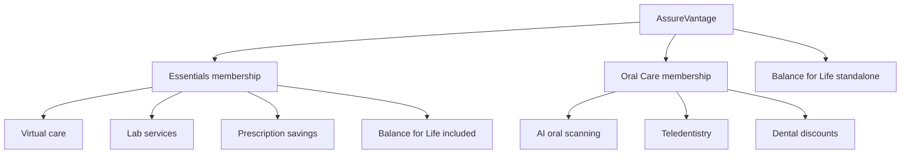

# AssureVantage customer experience audit — November 5, 2026

> Implemented customer-facing remediation: [November 6 refresh](customer-experience-refresh-2026-11-06.md). Findings below describe the original audit baseline.

## Assessment

AssureVantage currently feels like several inherited product websites joined by a navigation bar. A visitor can buy complementary memberships, but the company story, benefit relationships, visual system, help content and member experience do not yet communicate one coherent service.

The priority is to establish a consistent AssureVantage experience across discovery, choosing a membership, enrollment and using benefits. Adding more landing-page sections without fixing those relationships would multiply the existing inconsistencies.

There is a useful foundation: the shared catalog and cart work in the anonymous journeys checked, Balance for Life is removed as a separate charge when Essentials is added, the main program routes are connected, and the Balance for Life detail page demonstrates a more specific, useful explanation of a benefit. Preserve that functionality while improving presentation and information quality.

This is an evaluation and proposed implementation brief. No application code, production configuration, product entitlements or legacy Ideal marketing was changed by this audit.

## Scope and confidence

- Inspected production at `www.assurevantage.com`, plus its existing Clerk handoff to `www.getidealoh.com`. Source baseline: commit `264c2a2`.
- Browser audit: **28 requested paths on desktop, plus 10 mobile checks**. Desktop viewport 1440 × 1000; mobile viewport configured at 390 × 844. Supplementary checks cover a blog article, anonymous cart interactions, repeated error states and 320 CSS-pixel reflow.
- Examined rendered text, headings, navigation, links, metadata, screenshots, browser exceptions, failed HTTP responses and automated WCAG-tagged axe checks.
- Reviewed customer-facing source for the authenticated dashboard, plan management, checkout, registration and member materials. Admin pages and their internal systems were excluded. Employer/partner entry points were reviewed only as external-facing experiences.
- No authenticated member account was available for this evaluation. Successful payment, signed-in benefit access, vendor integrations, actual email delivery, cancellation and signed-in employer/partner tasks are **not verified**. No payment, account creation, agreement signature or outbound message was submitted.
- Timing observations are short desktop/mobile browser samples on this machine, without realistic network throttling. They are not field Core Web Vitals or Lighthouse scores. Automated accessibility findings require manual triage; repeated auth redirects audit the same sign-in screen more than once.
- Ideal's pre-session marketing remains frozen under `AGENTS.md`. Recommendations target AssureVantage and must preserve the legacy branch.

## 1. Findings ordered by customer impact

| Priority | Finding | Evidence and customer consequence | Recommended result |
| --- | --- | --- | --- |
| P0 | Essentials inclusion is contradictory | The homepage says the $58.95 bundle includes AI-powered oral care. The live catalog describes Oral Care separately. Adding Essentials and Oral Care produced **$73.94/month** in the anonymous cart. A customer can reasonably think they are being charged again for an included benefit. | Establish one authoritative membership/inclusion matrix, then align the homepage, catalog, detail pages, agreement, checkout, packets and portal. The audit does not resolve this business rule by changing purchased benefits. |
| P0 | Unsupported-looking trust statistics are published | Sign-in displays **50K+ active members, 99% satisfaction, $2.5M+ savings**. These are hardcoded in `src/app/health/sign-in/page.tsx:59`, with no supporting source attached to those constants. This does not prove they are false; it means their substantiation is not present in the implementation reviewed. | Remove from AssureVantage presentation until evidenced, or attach an attributable source, date and scope. Use actual service facts instead of invented testimonials or replacement statistics. |
| P0 | Activation and benefit terms disagree | How It Works promises activation within 24 hours, then says all benefits are active immediately upon payment. BFL says membership starts the first of the next month. Essentials says “10 free counseling sessions per year”; BFL says “up to 10 per life event.” | Display program-specific effective-date and usage rules consistently before purchase and in member instructions. Verify against current operational/vendor rules; do not invent a universal start date. |
| P0 | Manage Plans crashes for a signed-out visitor | `/assurevantage/manage-plans` repeatedly rendered a client-side application error, with `subscriptions/queries:getMyBundle` failing. Its shared customer overview links to management. HTTP 200 alone did not reveal the broken page. | Sign-in guard with a preserved return destination, authenticated query gating, and a useful error/retry state. Verify the signed-in flow with actual test memberships. |
| P1 | Homepage is an isolated selector | The root has no global navigation, member sign-in, cart, support, legal links or full footer. Its main content is a hero and three large cards. Returning home conceals a cart that still exists. | A genuine AssureVantage company homepage using the same shell as every other public page. |
| P1 | Common resources define the entire brand as dental | The FAQ says AssureVantage is an oral membership and that every plan includes AI scanning, teledentistry and the dental network. Its pricing answers cover only $14.99/$24.99 oral plans. | A whole-brand help center with common questions and separate program sections; dental-only answers explicitly scoped to Oral Care. |
| P1 | Site identity changes across the journey | Homepage uses a blue family-photo selector; BFL uses a cream/purple editorial page with serif headings and a phone illustration; other service pages use the oral site's gradients/cards; sign-in returns to the older dental header and claims. | One AssureVantage visual and interaction system, with restrained program accents. Preserve strong benefit-specific storytelling. |
| P1 | Old Ideal names remain in public content | The shared catalog's Oral Care selector displays “Ideal Oral Health Plan”; a sampled AssureVantage blog article still says “Ideal Health's Dental Discount Network.” Broker registration metadata also names Ideal. | Brand-aware presentation across public labels and editorial content, without renaming legacy records or altering existing member materials merely by hostname. |
| P1 | Mobile presentation breaks at shared components | Program footer stays in a three-column grid on narrow screens. The sticky public navigation wraps into multiple rows. At a 320 CSS-pixel viewport, Essentials and the catalog measured **404 pixels** of document width. | Responsive footer stacking, a deliberate mobile menu, bounded content and usable controls at 320 CSS pixels and larger. |
| P1 | Readability/accessibility needs systematic repair | Axe reported contrast issues on **23 of the 28 desktop route checks**, including repeated auth destinations. Examples: white text on orange CTA **2.8:1**; dark gray program-footer text on navy **2.35:1**; some savings-table text about **2.2:1**. Sign-in's password-visibility button has no accessible name and its autocomplete value is malformed. | Fix shared color tokens, focus/label patterns and form semantics; manually test keyboard navigation and a screen reader. Do not treat a color-only redesign as sufficient. |
| P1 | AssureVantage search metadata still follows the old site | Its production sitemap contains Ideal URLs; robots points to Ideal's sitemap. Many service pages canonicalize to `/assurevantage`, which redirects to `/`. Most program pages inherit an oral-only description. `SiteThemeProvider` overwrites document titles with the site name after hydration. | Host-aware AssureVantage sitemap/robots, correct page-specific canonicals and descriptions, and preserved page titles. Keep Ideal's existing behavior unchanged. |
| P1 | Member experience is not yet balanced across offerings | Source review of `DashboardTabs` shows Overview, Oral Scan, Teledentistry and Provider Search. No equivalent top-level telehealth, pharmacy, labs or BFL access is present in those tabs. The server dashboard also labels its subscription category “Oral Health.” | Entitlement-aware member home with an actionable card for every purchased program and accurate activation/status/support. Confirm actual signed-in behavior before marking complete. |
| P2 | Customer help and disclosures vary by page family | Program footer has program links and a short disclaimer, but lacks the support/legal links found in the oral footer. Root has neither. Existing Ideal support addresses are legitimate supplied contacts, but their relationship to AssureVantage is unexplained. | One footer and help destination; explicit program-specific support routing; preserve established contact details until replacements are actually operational. |
| P2 | Employer/broker acquisition is underdeveloped | `/employer` goes to an eligibility-upload sign-in flow rather than a public explanation of the offer. `/register/rep` is a functional form with Ideal metadata. `/register` cannot present an agreement and asks the visitor to request one. | Separate public employer/broker information from operational portals, and make readiness/next steps clear. No fabricated agreement or legal entity. |
| P2 | Editorial investment is almost exclusively oral | Blog index and sampled article are dental-focused. The Explore Services menu contains oral scanning, teledentistry and dental discounts, with no equivalent paths for the four Essentials components. | A balanced benefit/resource architecture with useful service guidance for virtual care, labs, pharmacy and mental wellbeing as well as oral care. |
| P2 | Empty/invalid states are uneven | `/assurevantage/claim-invite` without a token remained “Loading your invite…” on both the initial and an additional 11-second observation. Source condition `invite === undefined` takes precedence over the invalid-token state. Shop returns 404 while disabled; its nav link is hidden, so this is not evidence of a broken advertised offer. | Explicit invalid/expired-invite recovery, loading timeouts and support paths. Keep unavailable offers out of acquisition journeys. |

P0 means fix before driving more acquisition into the affected journey. P1 is foundational to the unified customer experience. P2 improves depth, trust and coverage after those foundations.

## 2. Visual and information quality

### Homepage

The page gives all three membership cards similar visual space, but that is not yet a complete brand experience. It does not explain the company, how the services work together, what happens after joining, where to get help, or why a customer should trust this organization. The largest message is generic; the first concrete explanation is a choice among separate offerings.

On the mobile capture, Oral Care fills the first complete product card and the other offers sit much farther down the page. The shared-catalog link comes after all three cards, approximately the bottom of a 2,375-pixel page. The architecture makes the customer choose a branch before understanding the whole service.

Use a compact overview of benefits and relationships near the top, then build confidence with concrete “how you use it” explanations, transparent pricing, eligibility/start-date information, help and verified provider relationships.

### Program pages

BFL is the strongest existing storytelling reference: it explains a scenario, shows a product illustration, distinguishes AI support from licensed care, describes the journey and connects the standalone product back to Essentials. Its own typography and large vendor logo, however, make it feel like another brand's site.

Essentials is mostly four tall vendor cards followed by a statistics strip and a CTA. It lists benefits but does not fully answer practical questions about using each service, eligibility, limitations, effective dates, or cost differences. Its visible page does not present the tier price matrix before the visitor follows “Choose Your Tier.”

Oral Care has much more surrounding content: a program overview, oral catalog, dental landing, scan explainer, teledentistry explainer, savings page and oral articles. That creates an imbalance rather than a consistently thorough explanation of the overall offering.

### Catalog and comparison

The catalog is a useful functional base, but the title “Three offerings. One shared checkout.” describes website mechanics. Customer-facing presentation should lead with the services, value and choice. “Shared cart” should simply be how the website behaves.

There are two types of plan browsing: the all-offerings catalog and the oral plan catalog. `/assurevantage/compare` routes toward the oral catalog, so it does not compare the company's memberships. Product labels also mix “Employee,” “Individual,” “Oral Care,” “Oral Savings” and a generic “AssureVantage Plan.” Establish consistent public vocabulary, explain family tiers, and make standalone versus included benefits visible in one comparison.

### Enrollment completion and member communications

The success-page source announces that the membership is active and that a welcome email will arrive within a few minutes. It does not read a verified order or effective date before displaying that message. This is a customer-state review finding, not evidence that the page can activate an unpaid membership. The eventual experience should distinguish enrollment received, payment/activation pending, active coverage and future-effective coverage, and give the member a direct next action rather than primarily sending them back to plans.

The Essentials packet already contains a stronger task-based structure than much of the public site: “I need to talk to a doctor,” “I need a prescription,” “I need lab service,” and “I need mental-health support.” Use that useful organization in the member dashboard and adapt non-private explanations for marketing. Member numbers, group/access codes and other enrollment identifiers must remain in protected instructions.

Source review also shows lifecycle messages with legacy Ideal subjects/wording, including the cancellation template. Their actual sending paths and enrolled-brand context need verification before claiming that all communications are fully unified. This audit did not send messages or inspect customer inboxes. A complete redesign includes receipts, welcome/activation messages, cards, agreements, cancellation notices and invite recovery, with consistent program-specific support and effective dates.

### Mobile and accessibility

The mobile menu is currently wrapped desktop navigation rather than a dedicated navigation pattern. At 390 pixels, several rows of links consume the top of every detail page; at 320 CSS pixels the measured navigation is roughly 227 pixels tall. Important content and CTAs begin below that persistent block.

Dark program footers inherit the site's default paragraph color, producing low-contrast gray text. Their fixed three-column grid is not a mobile layout. Screenshot inspection and the automated results agree that this is a shared component problem rather than a single bad page.

[W3C's contrast guidance](https://www.w3.org/WAI/WCAG22/Understanding/contrast-minimum.html) sets 4.5:1 for ordinary text and 3:1 for qualifying large text. [Its reflow guidance](https://www.w3.org/WAI/WCAG22/Understanding/reflow.html) covers ordinary content at 320 CSS pixels. These are verification targets, not a claim that this audit is a complete conformance assessment.

### Trust and clarity

The sign-in screen becomes a prominent marketing page during checkout. It currently sells a dental program with a 2,000-provider claim, while other pages say 100,000+ or 140,000+. Its “coverage” language also sits alongside “not insurance” disclosures. Provider network counts, savings ranges, pharmacy counts, counseling limits and activation promises need a common editorial source with program context and an evidence date.

A single footer can retain the correct dental disclosures where relevant while making the company's broader terms, privacy, membership documents and support paths available everywhere. This report identifies mismatched scope; it does not determine the legal sufficiency of those documents.

## 3. Coverage standard for every part of the offer

Equal investment should mean that every service answers the customer's important questions, rather than forcing identical page lengths or creating a new microsite for every vendor.

| Offering/capability | Current presentation | Information to complete and keep current |
| --- | --- | --- |
| AssureVantage overall | Three-choice selector; no full company homepage | Who this is for; what the brand provides; relationship between memberships; how to join/use benefits; credible company and support information |
| Essentials | Four vendor cards; catalog tiers elsewhere | Inclusion matrix; price/family tiers; start date; access process; limitations; how BFL relates to the bundle; definitive treatment of oral care |
| Virtual urgent/primary care and dermatology | A subsection in Essentials | Appropriate uses; how to request care; provider availability; visit/dermatology limits; prescription limitations; family eligibility; costs and effective date |
| QuestSelect labs | A subsection with broad no-cost claims | How orders work; eligible tests; where to go; what happens for excluded tests; member instructions without exposing private access identifiers |
| RxValet pharmacy | A subsection with broad medication/discount claims | Covered versus discounted drugs; formulary lookup; retail/mail-order process; exclusions; whether advertised GLP-1 pricing is current and its conditions |
| Balance for Life | Detailed standalone page plus an Essentials card | Consistent session limit, eligibility and start date; clearly scoped AI versus licensed services; standalone versus included pricing; practical access instructions |
| Oral Care | Multiple detail/catalog/editorial routes | One program overview with consistent price, provider counts, savings range, state availability, family rules and effective date; clean links into its three components |
| AI oral scanning | Dedicated explainer and member tab | Practical scan process; example report; limits of screening; escalation to professional care; clear route to the authenticated scan tool |
| Teledentistry | Dedicated explainer and member tab | How to start a consultation; clinically appropriate prescription limits; access conditions; emergency guidance sourced to current provider materials |
| Dental discount network | Dedicated savings page and provider-search tab | Current directory access; sample savings with context/date; exclusions/state limits; confirmation of participating providers before relying on advertised savings |
| Enrollment and account | One cart, two checkout implementations, shared Clerk login | Consistent review/sign-in/agreement/payment steps; totals and effective dates before commitment; retained referral/cart; accessible errors and recovery |
| Member support and ongoing use | Primarily oral portal navigation; packets for other programs | A purchased-benefit dashboard, welcome/onboarding, usable mobile cards/documents, program support and straightforward billing/cancellation |
| Employers and brokers | Operational portals and registration forms | Public overview, process, offer boundaries, appropriate lead/contact action, functioning approved registration documents |

Hospital Bill Eliminator is the separately documented CMG/Soars request. It should not become a sitewide AssureVantage benefit merely to fill a content gap. Likewise, the draft presentation's voluntary-insurance products are not evidence of an active public offering.

## 4. Recommended AssureVantage architecture

Present one company with a coherent set of memberships and benefit capabilities. Keep the existing vendor and membership boundaries accurate.

This diagram reflects the current all-offerings catalog's presentation, not a decision to change member entitlements. Resolve the homepage/oral-inclusion conflict first.

**Public navigation:** Benefits; Memberships & Pricing; How It Works; Resources; For Employers/Brokers; Help; Sign In; Cart. Use an actual AssureVantage logo and one mobile menu. Group lower-level services under Benefits rather than placing an oral-only menu above the rest of the site.

**Homepage sequence:** clear brand promise and audience; compact benefit overview; simple membership relationships; realistic examples of use; transparent plan comparison; how membership works; verified provider/company evidence; program-aware FAQs; help and full footer. Ensure mobile visitors discover the breadth before scrolling through several complete product sales cards.

**Benefit-detail template:** useful promise and fit; exact inclusion; realistic use case; what it costs and does not include; access steps; family/state eligibility and timing; relevant proof; targeted FAQs; clear next action. Allow authentic provider identity inside the AssureVantage design system.

**Pricing:** one canonical all-membership comparison, with specific individual/family tiers and billing cadence. Clearly distinguish standalone products, included services and additional purchases. Keep the selected total and next action easy to find on mobile.

**Account:** one branded sign-in and a membership-aware home showing the services this person actually owns, activation status, access instructions, documents, help and billing. Existing Clerk domain transport can continue behind this experience; unifying presentation does not require cloning the repository or creating another customer directory.

**URLs:** existing routes can remain while the shell and internal links improve. A later clean AssureVantage URL map can use redirects that preserve referral codes and deep links. Host-specific changes must not redirect or restyle frozen Ideal marketing.

## 5. Implementation sequence and acceptance criteria

| Stage | Work | Done when |
| --- | --- | --- |
| 1 — Truth and broken states | Reconcile inclusion/timing/session/support claims; substantiate stats; fix signed-out plan management and invalid-invite recovery | One tested source of benefit truth; public claims match checkout/fulfillment; expected auth and invalid-link states recover without crashes or endless loading |
| 2 — Shared brand system | AssureVantage typography, colors, spacing, image/art direction, buttons/forms, header, footer and mobile navigation | Every public route, including root and auth handoff, uses consistent brand behavior; readable contrast and 320-pixel reflow; legacy Ideal snapshots still pass |
| 3 — Homepage and membership architecture | New whole-company homepage, balanced benefits navigation, membership relationship/comparison | A first-time visitor can identify the company's services, included versus extra items, appropriate membership, cost and next step without following three separate site branches |
| 4 — Complete every benefit | Apply the common detail template to Essentials components, oral capabilities and BFL; build program-aware help/resources | Every row in the coverage matrix has accurate answers and an actionable next step; no broad dental-only claims describe unrelated programs |
| 5 — Enrollment and member experience | Consistent cart/review/agreement/payment shell, program-aware portal and onboarding | Actual test memberships demonstrate retained cart/referral, correct price/effective date, successful fulfillment, usable benefits and billing/cancellation recovery |
| 6 — Metadata and release QA | AssureVantage sitemap, robots, canonicals, titles/schema; responsive/accessibility/performance and external-user portal checks | Intended AssureVantage pages appear under the right host; private states have appropriate indexing controls; documented desktop/mobile/authenticated scenarios pass |

The existing cart should be reused. Its persistence and BFL deduplication were observed working. Any consolidation of the two checkout UIs must preserve agreements, pricing, attribution, payment behavior and legacy routes; those are functional requirements, not just visual refactoring.

### Release checks

- Root, all program pages, resources, sign-in and help share one predictable header/footer and preserve cart visibility.
- Shared catalog labels contain no unintended Ideal names on AssureVantage. Existing member/vendor/legal identities are changed only when appropriate to their real ownership.
- Every displayed inclusion, price, billing period, family rule, activation date and usage limit agrees with the selected product and its fulfillment.
- BFL-only, Essentials-only, oral-only and combined orders have equivalent quality. Existing members, dependents, canceled/pending memberships and invalid invites receive intentional states.
- Readability and keyboard/focus/form behavior pass manual review; 320, 390, 768 and desktop layouts remain usable. Automated axe findings are triaged and repaired.
- No unsupported trust statistics, testimonial claims, clinical claims or vendor promises are added for visual effect.
- Crawl metadata and public sharing previews describe the right benefit, not an inherited dental-only template.
- Use real field monitoring for Core Web Vitals. These browser samples are insufficient for a performance pass: [Google's Web Vitals guidance](https://web.dev/articles/vitals) explains the field metrics and distinction.
- Preserve the frozen Ideal templates and domain behavior. Test that a shared component or CSS change does not alter legacy marketing.

## 6. Evidence and reproducibility

### Visual comparisons

The six first-screen captures show the inconsistent page families. Cart state in the supplementary captures can include the audit's local selections; those interactions did not create a paid order.

| Page | Capture |
| --- | --- |
| Homepage | [Desktop first screen](customer-experience-audit-2026-11-05/fold-home.png) · [Full mobile page](customer-experience-audit-2026-11-05/mobile-home.png) |
| Essentials | [Desktop first screen](customer-experience-audit-2026-11-05/fold-essentials.png) · [Full mobile page and footer](customer-experience-audit-2026-11-05/mobile-assurevantage-essentials.png) |
| Balance for Life | [Desktop first screen](customer-experience-audit-2026-11-05/fold-bfl.png) |
| All-offerings catalog | [Desktop first screen](customer-experience-audit-2026-11-05/fold-catalog.png) |
| Oral catalog | [Desktop first screen](customer-experience-audit-2026-11-05/fold-oral.png) |
| Sign-in | [Desktop first screen](customer-experience-audit-2026-11-05/fold-signin.png) |
| Plan-management error | [Repeated anonymous error state](customer-experience-audit-2026-11-05/manage-plans-repeat.png) |

### Source anchors

- Homepage composition: `src/components/marketing/AssureLanding.tsx`; offer wording: `src/app/landing-cards.tsx`.
- Global navigation and visual rules: `src/components/assurevantage/PlatformNav.tsx`, `platform.module.css`.
- Catalog/inclusion behavior: `src/components/assurevantage/OfferingCatalog.tsx`; checkout selection: `SharedCheckout.tsx`.
- Different footers: `src/components/health/SiteFooter.tsx`; `src/components/newideal/NewIdealChrome.tsx`; `src/components/health/NexusHealthFooter.tsx`.
- Public claim conflicts: `src/app/health/sign-in/page.tsx:59`, `src/app/health/how-it-works/page.tsx`, `src/app/newideal/essentials/page.tsx:357`, `src/app/newideal/balance-for-life/page.tsx:255`, `src/app/health/faq/page.tsx`.
- Editorial legacy copy and metadata: `src/app/health/blog/[slug]/content.ts`, `src/app/[siteSlug]/blog/[slug]/page.tsx`.
- Metadata inheritance: `src/app/[siteSlug]/layout.tsx`; browser title overwrite: `src/components/providers/SiteThemeProvider.tsx:153`.
- Sitemap/robots: `src/app/sitemap.ts`, `src/app/robots.ts`.
- Member navigation: `src/components/health/DashboardTabs.tsx:52`; member overview: `src/app/health/dashboard/page.tsx`, `src/components/health/tabs/OverviewTab.tsx`.
- Error-state paths: `src/app/health/manage-plans/page.tsx`, `src/proxy.ts`, `src/app/health/claim-invite/page.tsx`.

### Machine-readable evidence

[Page/viewport observations and representative axe findings](customer-experience-audit-2026-11-05/page-evidence.json), [cart and recovery journeys](customer-experience-audit-2026-11-05/journeys.json), [production sitemap](customer-experience-audit-2026-11-05/sitemap.xml), [production robots](customer-experience-audit-2026-11-05/robots.txt), and [320-pixel reflow observations](customer-experience-audit-2026-11-05/reflow.json).

38 initial browser checks produced 33 checks with automated findings and 32 with contrast findings. The 190 flagged node occurrences are **not 190 distinct defects**: shared components and redirected sign-in pages repeat. Correcting shared components should remove many occurrences together. The disabled shop's 404 was the only failed HTTP response in the initial crawl; plan management's visible application error returned HTTP 200.

The live sitemap on the AssureVantage host lists Ideal URLs and advertises none of the AssureVantage program routes. [Google's sitemap documentation](https://developers.google.com/search/docs/crawling-indexing/sitemaps/overview) explains its role in page discovery; this audit makes no claim about current rankings or Search Console coverage.
